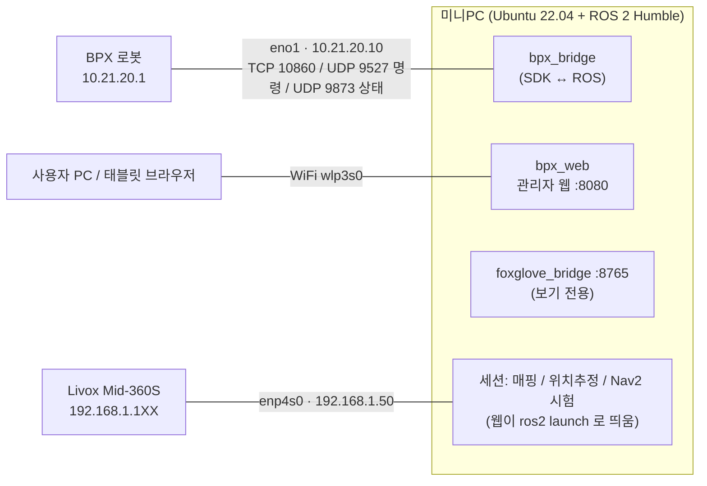

# BPX 4족로봇 ROS 2 개발 문서 (인수인계용)

최종 갱신: 2026-10-22 · 작성: Noah
대상: 이 프로젝트를 이어받는 개발자. 이 문서 하나로 구조를 파악하고, 설치·운용·시험을 할 수 있게 쓰였다.

> 처음 읽는다면 **1장 → 4장 → 9장(함정 목록)** 순서를 권한다.

---

## 0. 한눈에 보기

| 항목 | 내용 |
|---|---|
| 목표 | MirrorMe **BPX** 4족로봇을 로봇에 올린 **미니PC**에서 ROS 2로 제어. 매핑 → 위치추정 → 자율주행(Nav2) |
| 미니PC | MSI PRO Cubi Z AI 8M (Ryzen 7 255, 메모리 14 GB), Ubuntu 22.04, ROS 2 Humble |
| 로봇 연결 | 로봇 SDK `bpx_sdk_open` 1.0.9 (ROS 아님, 자체 TCP/UDP), 유선 RJ45 |
| 라이다 | Livox **Mid-360S** (3D). 매핑 FAST-LIO, 위치추정 NDT(lidar_localization_ros2) |
| 운용 화면 | 관리자 웹 `http://<미니PC>:8080` (부팅 시 자동 실행) |
| 현재 상태 | 로봇 연결·일어서기·앉기·웹 조종 완료. 라이다 미도착 → 매핑/위치추정은 공개 데이터로만 검증 |
| 저장소 | `~/bpx` (git, 브랜치 `main`, 원격 저장소 없음) |

---

## 1. 시스템 구성



### 네트워크
| 포트 | 용도 | 주소 | 비고 |
|---|---|---|---|
| eno1 | 로봇 | 10.21.20.10/24 → 로봇 10.21.20.1 | 기본 경로 없음 |
| enp4s0 | 라이다 | 192.168.1.50/24 → 라이다 192.168.1.1XX (XX = SN 끝 두 자리) | Livox 매뉴얼 기본값과 같음 |
| wlp3s0 | 인터넷·사용자 | DHCP (현재 192.168.30.52) | 공유기 고정 할당 권장 |

- 유선 두 포트는 **랜선이 없어도 IP를 유지**한다 (NetworkManager ignore-carrier). Livox 드라이버가 시작 때 IP가 없으면 실패하고 재시도하지 않기 때문.
- ROS_DOMAIN_ID = **90** (실서비스). 시험은 91~99 를 쓴다.

### 로봇 기본 사실
- 12 자유도, 관절 순서(SDK 인덱스 0~11) = FL, FR, HL, HR 각 (hip_roll, hip_pitch, knee) = URDF `{fl,fr,hl,hr}_{hip_roll,hip_pitch,knee}_joint`
- 동작 상태: LyingDown 0, StandingUp 1, Passive 2, SitDown 3, Motion 6
- 주행 순서: connect → setStandUp 반복 → 상태 6 → setVelocityControlFlag(True) → setVelocity
- 무게 15.2 kg, 탑재 한도 5 kg, 배터리 28.8 V 167 Wh (실측 약 6.0 Ah), 사용 시간 약 1.5 시간(사양)
- 후면 포트: **BAT Power Port (GND / 33V, 배터리 직결 추정)**, S-Bus(RC 수신기), RJ45, USB-C, E-Stop(평상시 열림)

---

## 2. 저장소 구조

```
bpx/
├── CLAUDE.md                 # 작업 규칙·검증된 사실·진행 상황 (가장 자세한 현황 메모)
├── README.md                 # 사용법 요약
├── bpx_ws/src/
│   ├── bpx_ros/              # ROS 2 패키지 (ament_python)
│   │   ├── bpx_ros/bridge.py        # ★ 핵심: SDK ↔ ROS 브리지
│   │   ├── bpx_ros/backend.py       # 실제 SDK / Fake 백엔드 (같은 메서드명)
│   │   ├── bpx_ros/gravity_logger.py# 매핑 시작 1초 중력 방향 기록
│   │   ├── bpx_ros/map_to_odom.py   # (예전 Zishen 방식, 현재 미사용)
│   │   ├── launch/                  # bringup / lidar / mapping(_session) / localization_session / nav
│   │   ├── config/                  # bridge.yaml, nav2.yaml, fastlio_mid360s.yaml
│   │   ├── urdf/, meshes/, rviz/, maps/empty.*
│   │   └── test/test_bridge.py      # 브리지 단위시험 30개
│   └── bpx_web/              # 관리자 웹 (FastAPI + rclpy 한 프로세스)
│       ├── bpx_web/server.py        # 웹 서버·ROS 노드·WebSocket
│       ├── bpx_web/maps.py          # 지도 저장소·자동 처리
│       ├── bpx_web/procs.py         # 세션 프로세스 관리
│       ├── bpx_web/checks.py        # 점검 탭 (배터리 기록·주행 점검 분석)
│       ├── bpx_web/settings.py      # 웹 설정 파일
│       ├── bpx_web/sysinfo.py       # 미니PC 상태
│       └── static/                  # index.html, app.js, style.css (빌드 없음)
├── scripts/                  # ROS 없이 쓰는 도구 (bpx_cmd, 지도 보정, bag 변환, 기록기)
├── setup/                    # 설치·네트워크·서비스 스크립트
├── tests/web/                # 관리자 웹 시나리오 시험 (fake 로봇)
├── docker/                   # 로봇 없이 시험 (Windows Docker)
├── third_party/bpx_sdk/      # SDK wheel (x86_64 / aarch64)
├── docs/                     # 매뉴얼 PDF, 업무일지, 이 문서, 전원 설계, 제조사 문의
├── lidar_ws/                 # (git 제외) 라이다 스택 소스·빌드, 시험 bag, 시험 로그
├── maps/                     # (git 제외) 지도 폴더들
├── logs/                     # (git 제외) 배터리·IMU 기록
└── config/                   # (git 제외) 웹 설정 web_settings.json
```

---

## 3. 새 PC에 설치하기

순서대로 실행한다. `~/bpx` 에 저장소가 있다고 가정한다.

```bash
bash ~/bpx/setup/setup_minipc.sh        # 1) ROS 2 Humble·Nav2·Foxglove·SDK·빌드·~/.bashrc
sudo bash ~/bpx/setup/net_bpx.sh        # 2) 유선 고정 IP (eno1=로봇, enp4s0=라이다), 포트 이름 다르면 인자로
bash ~/bpx/setup/install_livox.sh       # 3) Livox-SDK2·livox_ros_driver2·FAST-LIO·NDT 위치추정 (lidar_ws, 수십 분)
sudo bash ~/bpx/setup/install_service.sh  # 4) bpx-bridge 서비스 (부팅 시 읽기 전용 브리지 + 웹 + Foxglove)
```

- 3번은 **메모리 주의**: NDT/PCL 컴파일은 파일 하나가 최대 3.6 GB를 쓴다. 스크립트가 `-j2`, 메모리 상한 9 GB로 제한해 둠 (`-j8` 로 빌드하다 PC가 두 번 멈췄음).
- 외부 소스는 git 에 넣지 않고 스크립트가 **버전(태그/커밋)을 고정해서** 받는다:
  Livox-SDK2 v1.3.1, livox_ros_driver2 1.2.6, FAST-LIO ROS2 a4743b0954, ndt_omp_ros2 63bf15b965, lidar_localization_ros2 ba9f7f06db.
- 환경: `source ~/bpx/setup/bpx_env.sh` (ROS, lidar_ws, bpx_ws 순서로 겹쳐 씀).
- 코드 수정 후: `cd ~/bpx/bpx_ws && colcon build --symlink-install` → 파이썬 코드는 서비스 재시작(`sudo systemctl restart bpx-bridge`), 웹 정적 파일(static/)은 **브라우저 새로고침만** 하면 된다.

---

## 4. 운용 (관리자 웹)

브라우저: `http://192.168.30.52:8080` (인증 없음 → 사내 시험망에서만)

| 탭 | 하는 일 |
|---|---|
| **조종** | 상태, **조종 모드 스위치**, 일어서기/앉기/힘 풀기/비상 정지/관절 영점, 걷기·달리기, 조이스틱·키보드(W/S/A/D/Q/E), 지도·위치, 초기 위치, 목표 지정, **Nav2 시험** |
| **매핑** | 지도 이름 → 시작(라이다 또는 시험 bag) → 실시간 지도 → 저장하고 종료(수평 보정·2D 지도 자동) |
| **지도** | 지도 목록·미리보기·활성 지정·이름 변경·다시 처리·삭제, 활성 지도로 위치추정(+Nav2) 시작/정지 |
| **점검** | 배터리 장기 기록·완충/남은 시간, IMU 축 점검, 주행 점검(누르는 동안만), 거리 정확도, 서기 전력 |
| **진단** | 관절 12개, 모터/드라이버 온도, IMU, 펌웨어, 30분 추이 그래프 |
| **시스템** | 미니PC 자원·온도·포트 링크·ROS 노드, 브리지 재시작, **설정**(속도 상한·라이다·2D 지도) |

상단 바: 서버/로봇 연결, 배터리 게이지(충전·남은 시간), 충전 중·모터 과열 경고, 조종 모드.

### 처음 움직일 때 (안전 순서)
1. **충전기를 뺀다** (충전 중에는 로봇이 동작을 잠근다 — 9장).
2. 휴대폰 앱(BAOBOT)을 끈다. 이 펌웨어는 조종 주체를 알려 주지 않아 동시 조종을 막을 수 없다.
3. 주변 1~2 m 비우기, 후면 E-Stop 손 닿는 곳에.
4. 조종 모드 켜기 → 일어서기 → 속도 30% 정도로 조이스틱 → 앉기 → 조종 모드 끄기.

### 비상 정지
웹 "비상 정지"(= damping, 다리 힘 풀림) · 서비스 `ros2 service call /bpx_bridge/damping std_srvs/srv/Trigger` · **하드웨어 E-Stop 은 로봇 후면**.

### 웹 없이 (명령줄)
```bash
sudo systemctl stop bpx-bridge          # SDK 는 한 프로세스만 쥘 수 있다
python3 ~/bpx/scripts/bpx_cmd.py check  # 연결·상태 (안 움직임)
ros2 launch bpx_ros bringup.launch.py allow_motion:=true web:=true
sudo systemctl start bpx-bridge         # 끝나면 다시
```

---

## 5. 소프트웨어 구조

### 5.1 bpx_bridge (bpx_ros/bridge.py)
상태머신: `idle → standing → ready(속도 스트리밍) → sitting → idle`, 10 Hz 감시 + 50 Hz 명령.

| 구분 | 이름 | 내용 |
|---|---|---|
| 구독 | `/cmd_vel` | 속도 명령 (상한으로 자름, 0.5 s 끊기면 0) |
| 구독 | `/bpx/motion` (String) | 관제 연동 훅: stand / sit / damping / walk / run (zero 는 불가) |
| 발행 | `/odom/mc_odom` + TF `odom→base_link` | 다리 odom (LegOdom) 50 Hz |
| 발행 | `/joint_states`, `/imu/data`, `/battery_state` | 50 / 50 / 1 Hz |
| 발행 | `/bpx/status` (JSON) | 5 Hz: 연결·모드·동작 상태·조종 모드·충전·전류·상한 |
| 발행 | `/bpx/diag` (JSON) | 1 Hz: 모터/드라이버 온도·IMU rpy·최대 속도·펌웨어 |
| 서비스 | `~/stand ~/sit ~/damping ~/zero ~/walk ~/run` | Trigger |
| 서비스 | `~/set_motion` | SetBool, 조종 모드(allow_motion) 실행 중 전환 |
| 파라미터 | `max_vx/vy/wz`, `cmd_timeout` | 실행 중 변경 가능 (SDK 상한 1.5/0.5/2.0 초과 거부) |

### 5.2 TF
```
map ─(위치추정 또는 Nav2 시험의 고정 TF)→ odom ─(bridge)→ base_link ─(URDF)→ torso → 다리
                                                       └─(lidar.launch static)→ livox_frame
FAST-LIO 매핑 중에는 별도: camera_init → body
시험 bag 위치추정: map → bag_base_link (브리지와 충돌 방지)
```

### 5.3 세션 (웹이 실행, 동시에 하나)
| 세션 | launch | 구성 |
|---|---|---|
| 매핑 | `mapping_session.launch.py` | lidar.launch(CustomMsg) + FAST-LIO + gravity_logger (또는 bag 재생) |
| 위치추정 | `localization_session.launch.py` | lidar.launch(PointCloud2) + lidar_localization(NDT, Nav2 모드 map→odom) + map_server (+ Nav2) |
| Nav2 시험 | `nav.launch.py` | 빈 지도 + map→odom 고정 + Nav2 (라이다 없이) |

정지는 SIGINT → SIGTERM → SIGKILL (라이다 미연결 Livox 드라이버는 SIGINT/TERM 을 무시). 로그 `~/.ros/bpx_web_sessions/`.

### 5.4 지도 (`~/bpx/maps/<이름>/`)
| 파일 | 내용 |
|---|---|
| map.pcd | FAST-LIO 원본 3D 점군 (출발 자세 기준이라 기울 수 있음) |
| gravity.json | 매핑 시작 1초 IMU 평균 중력 방향 |
| map_level.pcd | 중력 방향으로 수평 보정 → **위치추정용** |
| map.yaml / map.pgm | Nav2 2D 지도 (지면 기준 장애물 높이로 잘라 냄) |
| preview.png, meta.json | 웹 미리보기, 정보 |

활성 지도: `~/bpx/maps/active.json`. 처리: `scripts/align_map_gravity.py` → `generate_occupancy_map_from_pcd`.
**방침: 3D 지도가 기준, 2D는 파생본.** 위치추정은 3D(4족 몸 흔들림에 강함), 경로 계획은 2D(Nav2).

### 5.5 설정 파일
| 파일 | 내용 |
|---|---|
| `bpx_ws/src/bpx_ros/config/bridge.yaml` | 브리지 기본값 (allow_motion false, 상한 0.4/0.25/1.0, 50 Hz) |
| `config/nav2.yaml` | Nav2 (MPPI Omni, NavFn, footprint 0.70×0.40 m, 장애물 레이어 없음) |
| `config/fastlio_mid360s.yaml` | FAST-LIO (blind 0.5 m, Mid-360 외부 파라미터 + 온라인 추정) |
| `~/bpx/config/web_settings.json` | 웹 설정: 라이다 IP·장착 자세, 2D 지도 기준 (웹 시스템 탭에서 편집) |
| `setup/bpx-bridge.service` | 자동 실행: `bringup.launch.py allow_motion:=false foxglove:=true web:=true` |

---

## 6. 안전 설계 요약
- 부팅·브리지 재시작 시 **항상 읽기 전용** (allow_motion=false). 웹 "조종 모드"를 켜야 명령이 나간다.
- 자동으로 일어서지 않는다 (auto_stand=false).
- `/cmd_vel` 0.5 s 끊기면 0, 속도 상한을 브리지와 웹 양쪽에서 적용, 상한 변경도 SDK 보행 상한 안에서만.
- 조이스틱·주행 점검은 **누르는 동안만** 명령. 손 떼기·창 이탈·접속 끊김 → 즉시 0.
- 조종 모드를 끄면 속도 0 + 속도 플래그 해제 (서 있던 로봇은 계속 서 있음 → 앉힌 뒤 끌 것).
- 충전 중 일어서기는 즉시 거부 (전류 > +0.5 A 로 판정), 관절 영점은 엎드림·대기 상태에서만 + 확인 창.
- 종료(Ctrl+C·SIGTERM) 시 서 있었다면 정지 후 앉힌다.
- Foxglove 는 보기 전용 (원격 발행·서비스 호출 차단). 관리자 웹은 인증 없음 → 사내망 전용.

---

## 7. 시험 방법

| 시험 | 명령 | 내용 |
|---|---|---|
| 브리지 단위시험 | `cd ~/bpx/bpx_ws && colcon test --packages-select bpx_ros` 또는 `python3 -m pytest src/bpx_ros/test -q` | 30개: 읽기 전용, 서기 타임아웃, 재연결, 탈취, 충전, 영점, 보행, 상한 등 (가짜 시계) |
| 웹 시나리오 | `tests/web/README.md` | fake 로봇으로 조종 10 · 점검 7 · 설정/Nav2 9 · 매핑/지도 15 · IMU 판정 |
| Docker | `docker/test_fake.sh` | 로봇 없는 Windows PC 에서 브리지 흐름 18항목 |
| 라이다 없이 매핑/위치추정 | 웹 매핑/지도 탭에서 입력 "시험용 bag" | 공개 Mid-360 bag |

### 시험 데이터 (git 제외, `~/bpx/lidar_ws/bags/`)
- `rosbag2_2024_04_16-14_17_01/` — AIST "Driving SLAM Test with Livox MID360" (Zenodo 14841855, CC BY 4.0, 277 s, PointCloud2)
- `aist_custom/` — 위를 FAST-LIO 입력(CustomMsg)으로 변환: `scripts/livox_pc2_to_custom.py`
- 다시 받기: `https://zenodo.org/records/14841855/files/rosbag2_2024_04_16-14_17_01.zip` (MD5 0836c50859bb1af591966b69da166186)

---

## 8. 실기에서 확인된 사실 (2026-10-19 ~ 22)
| 항목 | 결과 |
|---|---|
| 로봇 펌웨어 | **1.0.14** (2026-08-18). 제조사 검증은 1.0.15 |
| 통신 | 상태 UDP 9873 (~100/s), 세션 TCP 10860, 명령 UDP 9527 (50 Hz) — 패킷 캡처로 확인 |
| IMU (BPX) | 가속도 **m/s²**, z 위, 엎드림 roll/pitch ≈ 0 → base_link 와 수평. x/y 축 방향은 웹 점검 탭으로 확인 예정 |
| 관절 | 엎드림 pitch +1.1~1.2, knee −2.7~−2.8 rad → URDF 부호 일치 |
| 온도 | ℃ |
| 배터리 전류 | **A, 양수 = 충전** (충전 +2.38, 엎드림 대기 −0.64) |
| 충전 | 정전류 2.38 A(약 69 W), 시간당 약 40%, 100% 환산 약 6.0 Ah → 잔량 % 정확 |
| 충전 중 | 로봇이 **max_vel 을 0 으로 잠그고 일어서기를 무시** |
| 지원 안 됨 (1.0.14) | ControlMode·SN·모델 → None, **getChargerIn1/2 는 충전 중에도 0 (틀림)** |
| Livox IMU | 가속도 단위 **g** (BPX IMU 와 다름) |

---

## 9. 함정 목록 (실제로 겪은 것)
1. **로봇이 안 일어선다** → 충전기가 꽂혀 있는지부터. SDK 충전 플래그는 믿지 말고 **배터리 전류 부호**를 본다. 명령이 나가는지는 `tcpdump -i eno1 udp port 9527`.
2. **SDK 는 한 프로세스만**: 서비스가 돌고 있으면 `bpx_cmd.py`·수동 launch 금지 → `sudo systemctl stop bpx-bridge` 먼저.
3. **빌드하다 PC가 멈춘다** → lidar_ws 는 `-j2` + 메모리 상한 (install_livox.sh 그대로 쓸 것).
4. **/tmp 에 둔 파일은 재부팅 때 사라진다** → bag·결과는 `~/bpx/lidar_ws/` 아래.
5. **FAST-LIO 지도가 기울어 있다** → 출발 자세 기준이라 정상. gravity.json 으로 보정한 `map_level.pcd` 를 쓴다.
6. **Livox 드라이버가 bind 실패** → 라이다 포트 IP 가 없을 때. ignore-carrier 설정(net_bpx.sh) 확인.
7. **Livox 드라이버가 안 죽는다** → 라이다 미연결 시 SIGINT/TERM 무시. SIGKILL.
8. **시험 bag 위치추정에서 위치가 안 움직인다** → 실행 중 브리지와 base_link TF 충돌. bag 모드는 bag_base_link 를 쓴다.
9. **비대화형 셸에서 `ros2 launch ... &`** → SIGINT 무시 상태로 상속되어 `kill -INT` 가 안 먹는다. 노드 PID 에 직접 신호.
10. **uvicorn WebSocket 오류** → Ubuntu 22.04 websockets 9.1 이 Python 3.10 과 안 맞음. `ws='wsproto'` 필수.
11. **웹 SVG 아이콘 숨기기** → `.hidden` 이 SVG 에는 안 먹음. `toggleAttribute('hidden')`.
12. **Mid-360S 시야는 −7°~+52° (위쪽 위주)** → 수평 장착 시 로봇 앞 약 3 m 안의 낮은 장애물을 못 본다. 거꾸로 또는 숙여서 장착 권장.

---

## 10. 남은 일 (우선순위)
1. **실기 점검** (충전기 분리 후, 웹 점검 탭): 주행 방향·추종률, 거리 정확도, 서기·걷기 소비 전력, IMU 축
2. **Nav2 시험** (조종 탭): 라이다 없이 1~2 m 목표, MPPI 파라미터 조정
3. **제조사 문의 발송**: `docs/제조사문의_2026-10-22.md` (배터리 포트 전류, 충전 플래그, 펌웨어, 우선순위, BMS)
4. **펌웨어 업데이트 검토** (앱 OTA, 1.0.14 → 최신)
5. **라이다 도착 시**: 장착 방향·높이 결정 → 웹 설정 → 실제 장소 매핑 → 위치추정 → Nav2 (장애물 레이어 추가 필요: `nav2.yaml` 은 아직 static+inflation 만)
6. **전원 설계 확정**: `docs/전원설계_초안.md` (DC-DC 두 종, 퓨즈) — 1·3번 결과 필요
7. 관리자 웹 인증 (현장 망이 공용이면 필수)

---

## 11. 참고
- 제조사 GitHub: github.com/mirrormerobotics (bpx_sdk_open, BPX, BPX-Pro, robot-mirrorme-bpx, primitive-mirrorme-bpx-quadruped-rbnx, bpx-mindplus-extension, mirrorme_rl_train)
  — 로컬 사본 `~/bpx/lidar_ws/vendor_ref/` (git 제외)
- 매뉴얼: `docs/BPX User Manual.pdf` (p13 포트 설명), `docs/BPX Assembly Manual.pdf`
- 기술지원: support@mirrormetech.com
- 업무일지: `docs/업무일지_2026-10-13.md` ~ `2026-10-21.md` (결정 이유와 경과)
- 현황 메모(가장 자세함): `CLAUDE.md`
