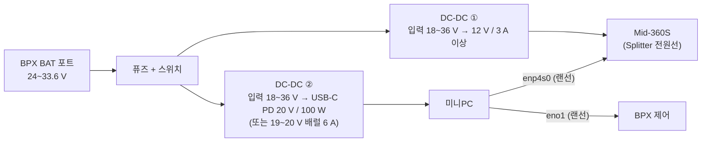

# BPX 탑재 전원 설계안 (초안)

작성 2026-10-22 · 상태: **초안** (로봇 소비 전력 실측, 배터리 포트 허용 전류 확인 후 확정)

## 1. 목적
로봇 배터리 하나로 로봇 + 미니PC + 라이다를 함께 돌린다 (별도 배터리 없이).
전원은 로봇 후면 **BAT Power Port (GND / 33V)** 에서 받는다.

## 2. 전원과 부하
| 항목 | 값 | 출처 |
|---|---|---|
| 배터리 | 8S2P 리튬이온, 공칭 28.8 V (24.0~33.6 V), 5.8 Ah / 167 Wh | 판매처 사양 |
| 배터리 용량 실측 | 충전 기록으로 환산 약 6.0 Ah | 2026-10-22 실측 |
| BAT 포트 출력 | 배터리 전압 그대로로 추정 (24~33.6 V), **허용 전류 미확인** | 사용자 매뉴얼 p13, 제조사 문의 중 |
| 미니PC (MSI PRO Cubi Z AI 8M) | 정품 어댑터 120 W, USB-C PD 입력 최대 100 W. 평상시 사용 전력 미측정 | MSI 사양 |
| 라이다 (Livox Mid-360S) | 9~27 V, 권장 12 V, 평상 6.5 W, 기동 18 W (약 8초) | Livox 매뉴얼 |
| 로봇 자체 | 엎드림 대기 약 18 W (−0.64 A), 서기·걷기 **미측정** | 실측 / 점검 탭에서 측정 예정 |

## 3. 구성안

- **라이다 (DC-DC ①)**: 12 V 출력, 3 A(36 W) 이상. 기동 18 W를 여유 있게 감당하고, 라이다 허용 상한(27 V)보다 훨씬 낮다.
  **배터리 포트(최대 33.6 V)에 라이다를 직접 연결하면 안 된다.**
- **미니PC (DC-DC ②)**: 입력 18~36 V를 받는 **USB-C PD 출력 컨버터(20 V, 100 W)** 를 우선 추천한다.
  미니PC가 USB-C PD 입력을 지원하고 커넥터가 단단하다. 배럴 잭 쪽은 출력 전압·극성을 정품 어댑터와 맞춰야 한다.
- **퓨즈·스위치**: BAT 포트 바로 뒤에 둔다. 퓨즈 용량은 제조사가 알려 줄 포트 허용 전류에 맞춘다.
- **입력 범위**: 배터리가 24 V 가까이 떨어져도 두 컨버터가 동작해야 하므로 입력 하한 18 V 이하 제품을 고른다.

## 4. 사용 시간 영향 (어림 계산, 실측 후 갱신)
배터리 사용 가능 에너지 약 160 Wh 기준이다.

| 상황 | 로봇 | 미니PC + 라이다 (가정) | 합계 | 사용 시간 |
|---|---|---|---|---|
| 걷기 (사양 1.5시간 역산) | 약 105 W | 0 | 105 W | 약 1.5 시간 |
| 걷기 + 탑재 장비 | 약 105 W | 30~50 W (변환 손실 포함) | 135~155 W | **약 1.0~1.2 시간** |

→ 로봇의 서기·걷기 전력과 미니PC 실사용 전력을 점검 탭에서 측정하면 이 표를 확정한다.

## 5. 확정 전에 할 일
1. 제조사 회신: BAT 포트 최대 전류, 퓨즈 유무, 로봇 꺼짐·비상정지 때 출력 유지 여부, 커넥터 품번
2. 실측: 로봇 서기·걷기 전류 (점검 탭 "소비 전력", "주행 점검"), 미니PC 평상·최대 전력 (USB-C 전력계)
3. 부품 선정: DC-DC 두 종, 퓨즈, 커넥터·배선. 탑재 무게는 로봇 탑재 한도 5 kg 안에서 관리
4. 시험대에서 먼저 연결해 보고 (전압 강하, 라이다 기동 순간, 미니PC 부팅) 로봇에 올린다
